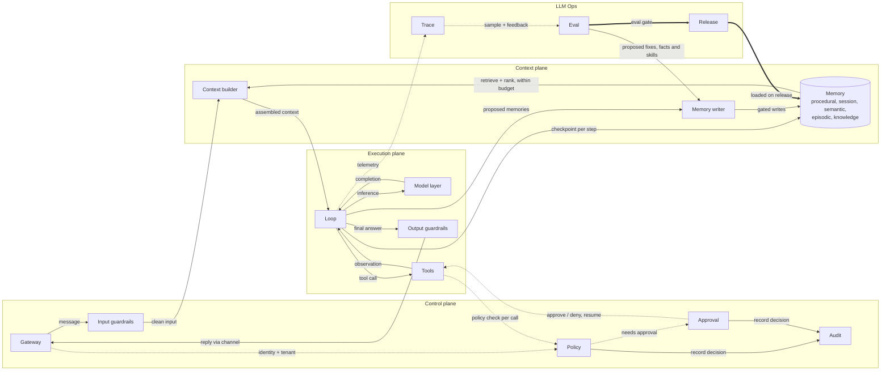

# harnesswalk

**Walk through an AI harness, one node at a time.**

Status: **pre-alpha, P0 spec.** There is no runtime yet. This repository holds the specification,
the canonical diagram, the event contract and the conformance cases that the first runnable
slice (P1) will be built against. See [docs/ROADMAP.md](docs/ROADMAP.md).

## What this is

An agent is a model inside a harness. The harness is everything else: the gateway that decides
who is asking, the guardrails that check what goes in and out, the policy that decides which
tools may run, the context builder that chooses what the model sees, the memory it reads and the
gate that controls what it writes, the loop, the tools, the trace, the evals, the release
process. Most teaching material shows the loop. The harness is where most of the engineering is.

harnesswalk is an open-source, local-first harness built to be read. One command will bring up
a working agent and a web page with two panels: a chat, and a live systems diagram of the
harness. Send a message and watch it travel. Every node lights up as the request passes through
it. Click a node to see what is behind it: the code for a guardrail, the rules for policy, the
skills in procedural memory, the assembled context with a budget bar per slice, the timeline in
the trace.

## Walk through it one node at a time

Turn on step mode and the harness stops at every node, like a debugger. Press Next and the
request moves one hop. The inspector of the current node stays open beside a short lesson: what
the node does, what breaks without it, and something to try. Replay does the same over a past
turn without calling the model again.

The lessons follow the same order as the walk, so reading the course and stepping through a
request are the same activity.

## The diagram

Fifteen nodes in four groups in the simple view. The expert view expands memory, the model
layer, tools, trace, eval and release into 14 more nodes. The diagram is data
([spec/diagram/diagram.json](spec/diagram/diagram.json)) and the running harness serves it from
its registered components, so the picture cannot drift from the code.



Solid arrows carry requests and data, dotted arrows carry control and telemetry, thick arrows
carry releases.

## Principles

1. **Glass box.** Every component is small, readable and inspectable from the UI.
2. **The event stream is the product.** Every node emits typed events. The animation, the trace
   store, step mode, replay and the evals all read the same stream. Emit the events from any
   language and you get the UI.
3. **Code for controls, text for intent.** Guardrails, policy and budgets are code and config.
   Prompts and skills carry intent. The UI shows which is which.
4. **Local-first.** Runs offline with a local model. Hosted models are optional.
5. **Learn by poking.** Edit a skill, change a budget, add a policy rule, switch a node off, run
   the same prompt again, and watch the diagram change.
6. **Framework-free core.** The loop is plain code you can read. Agent frameworks appear only as
   optional adapter examples that show where they would plug in.

## How it relates to waku-agent

[waku-agent](https://github.com/ShenSeanChen/waku-agent) is the closest existing project, and a
good one: a readable Python assistant with a loop, three kinds of memory, tools, traces, evals, a
release gate, and a dashboard whose architecture picture lights up live. We learned from it and
adopt several of its ideas: one event stream for UI, trace and evals; a "things to try" table;
deterministic and judged evals kept apart; a per-turn cost receipt; providers as data; topology
derived from code.

harnesswalk aims at a different spot. What it adds:

- Input and output guardrails, policy with action classes, and human approval as real nodes on
  the request path.
- An inspectable context builder with a token budget per slice.
- Knowledge retrieval (RAG) and five starter datasets, so a learner can ask real questions in
  minute one.
- Docker Compose for the learner path, with a local model.
- A data-driven diagram where clicking a node opens its code, prompt, skill or config, and step
  mode that walks a request one node at a time.
- A lesson sequence bound to the diagram.
- A published event schema and a conformance suite, so other runtimes can light the same diagram.
- One permissive licence (Apache-2.0) for the whole learner path, with dataset content under CC0.

If you want a personal assistant you can read in an afternoon, use waku-agent. If you want to
see every stage of a production-style harness and step through it, that is what this project is
for.

## The spec comes first

The contract is in [`spec/`](spec/), written before the code:

| Path | What it fixes |
|---|---|
| [spec/harness.md](spec/harness.md) | Planes, nodes, invariants, the multi-tenant rule, modes |
| [spec/diagram/](spec/diagram/) | Canonical node ids, edges, lessons, walk order |
| [spec/events.schema.json](spec/events.schema.json), [spec/events.md](spec/events.md) | The harness event contract and its OpenTelemetry mapping |
| [spec/contracts/](spec/contracts/) | One interface per component, plus the HTTP API |
| [spec/conformance/](spec/conformance/) | Black-box cases any implementation can run |

The reference implementation will be Python (FastAPI) in [`harnesswalk/`](harnesswalk/), with a
TypeScript web UI in [`web/`](web/). A TypeScript harness port is planned to prove the spec.

## Try it (today)

```sh
make setup        # uv sync
make test         # checks the spec: schemas, examples, diagram, conformance files
make lint
```

`make run` and `make conformance` print what they will do once P1 lands.

## Repository layout

```
spec/       the language-agnostic contract
harnesswalk/ reference implementation (Python), skeleton only
web/        chat and diagram UI (P2)
datasets/   five starter packs (P5)
lessons/    one chapter per node (P5)
deploy/     docker compose: dev and homelab profiles
docs/       roadmap
tests/      spec checks now, harness tests from P1
```

## Licence

Code and documentation: [Apache-2.0](LICENSE). Starter dataset content: CC0 1.0. Copyright 2026
Vince Elizaga.
