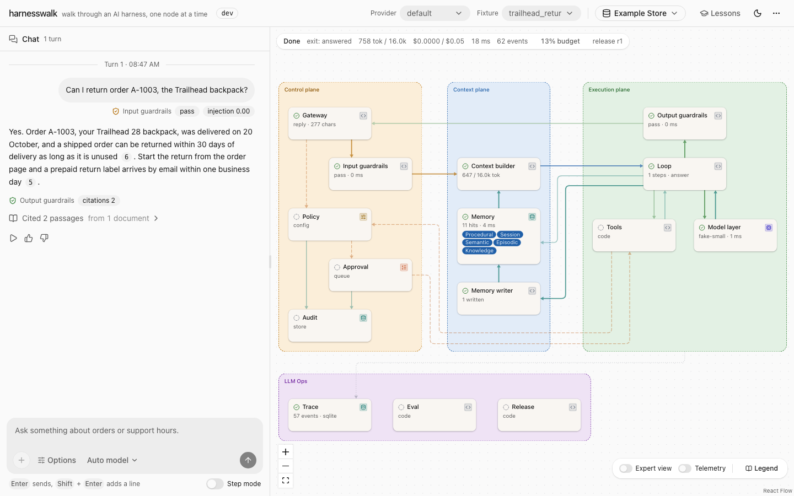
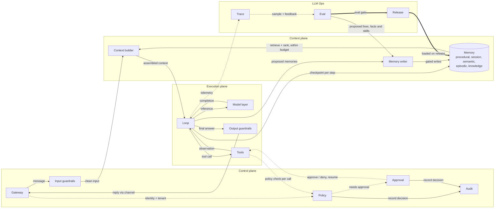
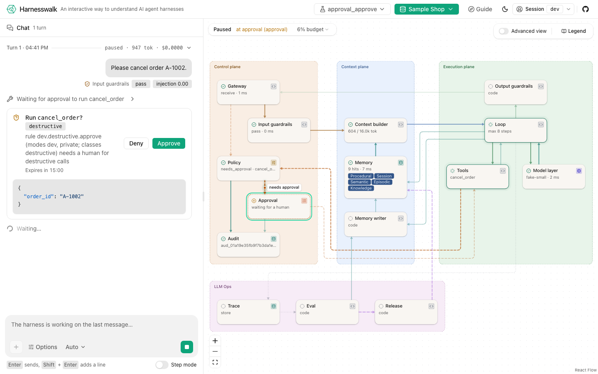
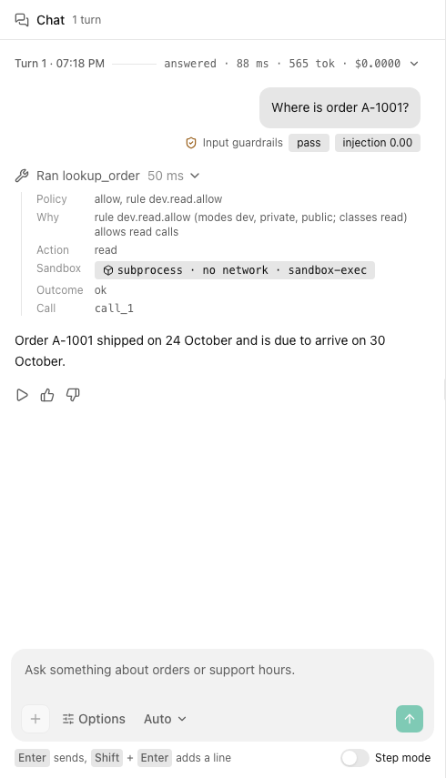
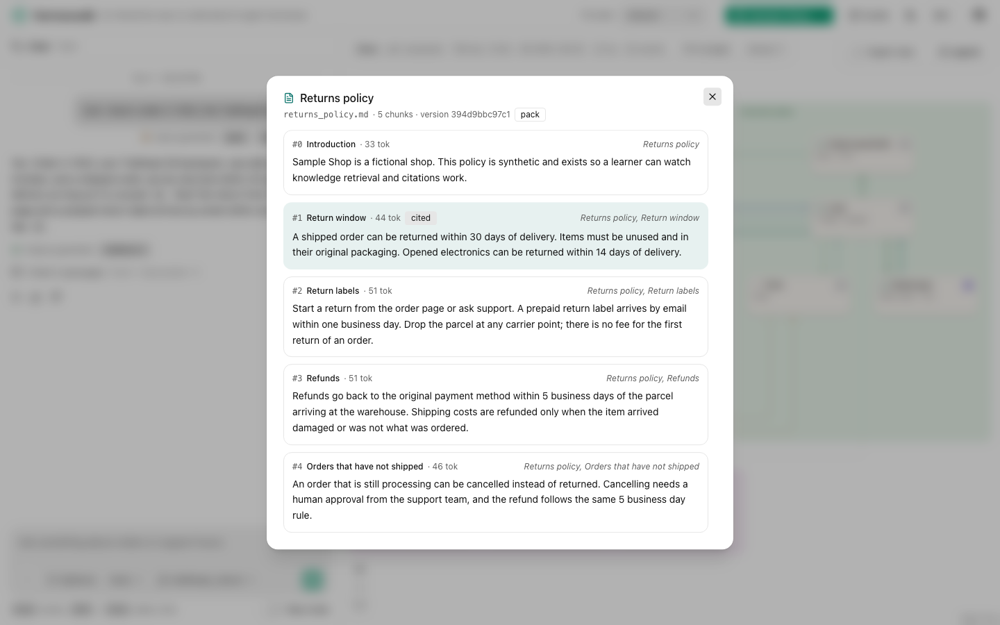
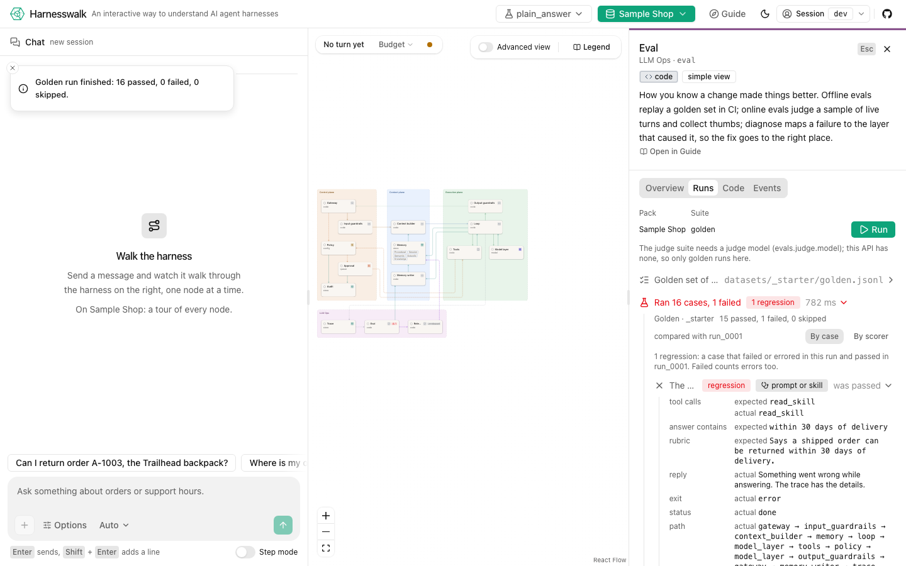
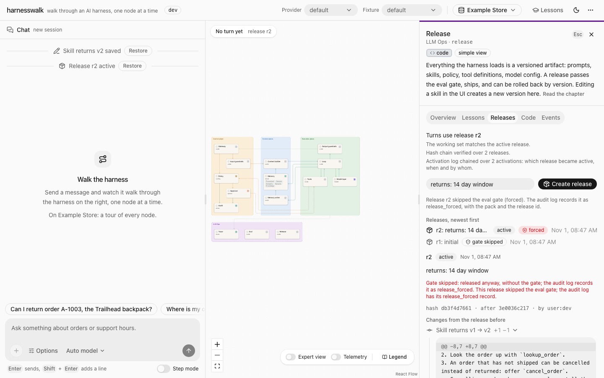
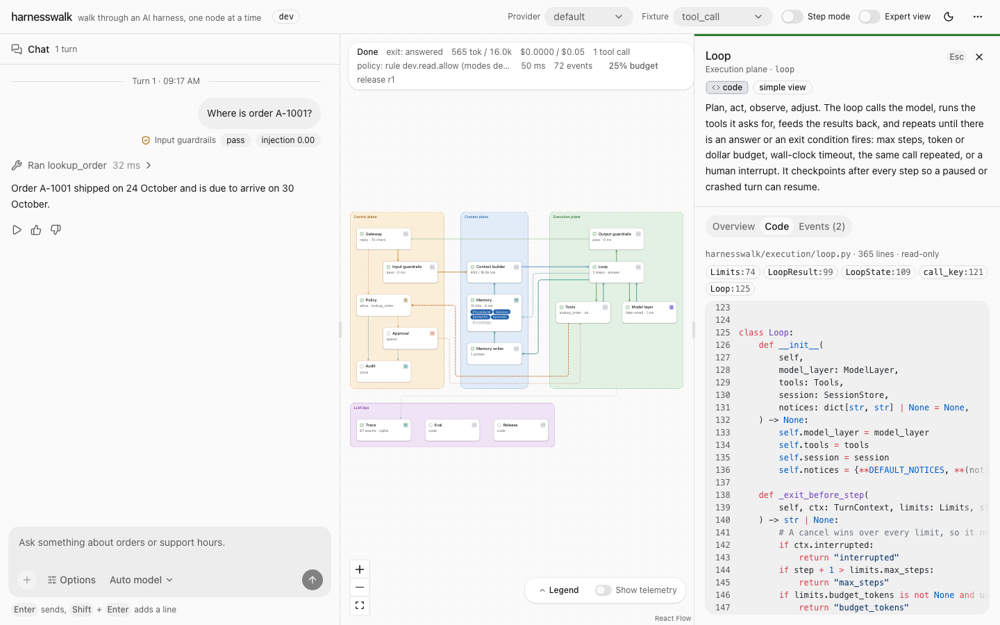
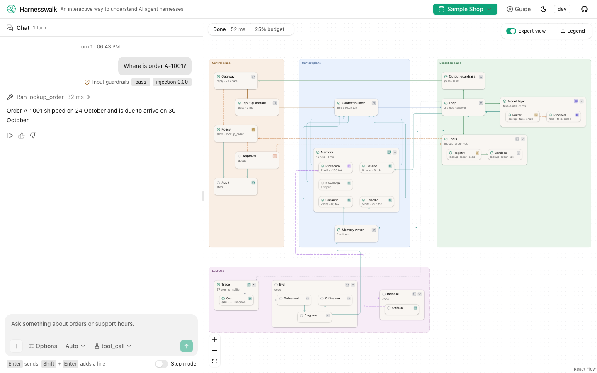

# harnesswalk

**Walk through an AI harness, one node at a time.**

Status: **pre-alpha, P2 web UI.** The harness runs: a request walks the gateway, guardrails,
context builder, memory, loop, model layer, tools, policy, approval, audit and trace, and every
step is an event you can stream, store and replay. The web UI shows it: a chat beside a live
diagram, step mode, approvals, replay and a code peek per node. See
[docs/ROADMAP.md](docs/ROADMAP.md).



## What this is

An agent is a model inside a harness. The harness is everything else: the gateway that decides
who is asking, the guardrails that check what goes in and out, the policy that decides which
tools may run, the context builder that chooses what the model sees, the memory it reads and the
gate that controls what it writes, the loop, the tools, the trace, the evals, the release
process. Most teaching material shows the loop. The harness is where most of the engineering is.

harnesswalk is an open-source, local-first harness built to be read. One command brings up
a working agent and a web page with two panels: a chat, and a live systems diagram of the
harness. Send a message and watch it travel. Every node lights up as the request passes through
it. Click a node to see what is behind it: the code for a guardrail, the rules for policy, the
skills in procedural memory, the assembled context with a budget bar per slice, the timeline in
the trace.

## Walk through it one node at a time

Turn on step mode and the harness stops at every node, like a debugger. Press Next and the
request moves one hop. The inspector of the current node stays open beside a short lesson: what
the node does, what breaks without it, and something to try. Replay does the same over a past
turn without calling the model again.

The lessons follow the same order as the walk, so reading the course and stepping through a
request are the same activity.

## The diagram

Fifteen nodes in four groups in the simple view. The expert view expands memory, the model
layer, tools, trace, eval and release into 14 more nodes. The diagram is data
([spec/diagram/diagram.json](spec/diagram/diagram.json)) and the running harness serves it from
its registered components, so the picture cannot drift from the code.



Solid arrows carry requests and data, dotted arrows carry control and telemetry, thick arrows
carry releases.

## Principles

1. **Glass box.** Every component is small, readable and inspectable from the UI.
2. **The event stream is the product.** Every node emits typed events. The animation, the trace
   store, step mode, replay and the evals all read the same stream. Emit the events from any
   language and you get the UI.
3. **Code for controls, text for intent.** Guardrails, policy and budgets are code and config.
   Prompts and skills carry intent. The UI shows which is which.
4. **Local-first.** Runs offline with a local model. Hosted models are optional.
5. **Learn by poking.** Edit a skill, change a budget, add a policy rule, switch a node off, run
   the same prompt again, and watch the diagram change.
6. **Framework-free core.** The loop is plain code you can read. Agent frameworks appear only as
   optional adapter examples that show where they would plug in.

## How it relates to waku-agent

[waku-agent](https://github.com/ShenSeanChen/waku-agent) is the closest existing project, and a
good one: a readable Python assistant with a loop, three kinds of memory, tools, traces, evals, a
release gate, and a dashboard whose architecture picture lights up live. We learned from it and
adopt several of its ideas: one event stream for UI, trace and evals; a "things to try" table;
deterministic and judged evals kept apart; a per-turn cost receipt; providers as data; topology
derived from code.

harnesswalk aims at a different spot. What it adds:

- Input and output guardrails, policy with action classes, and human approval as real nodes on
  the request path.
- An inspectable context builder with a token budget per slice.
- Knowledge retrieval (RAG) and five starter datasets, so a learner can ask real questions in
  minute one.
- Docker Compose for the learner path, with a local model.
- A data-driven diagram where clicking a node opens its code, prompt, skill or config, and step
  mode that walks a request one node at a time.
- A lesson sequence bound to the diagram.
- A published event schema and a conformance suite, so other runtimes can light the same diagram.
- One permissive licence (Apache-2.0) for the whole learner path, with dataset content under CC0.

If you want a personal assistant you can read in an afternoon, use waku-agent. If you want to
see every stage of a production-style harness and step through it, that is what this project is
for.

## The spec comes first

The contract is in [`spec/`](spec/), written before the code:

| Path | What it fixes |
|---|---|
| [spec/harness.md](spec/harness.md) | Planes, nodes, invariants, the multi-tenant rule, modes |
| [spec/diagram/](spec/diagram/) | Canonical node ids, edges, lessons, walk order |
| [spec/events.schema.json](spec/events.schema.json), [spec/events.md](spec/events.md) | The harness event contract and its OpenTelemetry mapping |
| [spec/contracts/](spec/contracts/) | One interface per component, plus the HTTP API |
| [spec/conformance/](spec/conformance/) | Black-box cases any implementation can run |

The reference implementation is Python (FastAPI, no agent framework) in
[`harnesswalk/`](harnesswalk/), and the TypeScript web UI is in [`web/`](web/). A
TypeScript harness port is planned to prove the spec.

## Try it

You need [uv](https://docs.astral.sh/uv/) (Python 3.12 or newer), and for the web app Node 24
with pnpm 10 (`corepack enable` gives you the pinned pnpm).

### The web app

```sh
make setup && make web-build && make run PROVIDER=fake
```

Then open http://127.0.0.1:8000. `make run` serves the API and the built app from one process on
`127.0.0.1:8000`. With `PROVIDER=fake` no model is needed: the fake provider replays scripted
replies. With [Ollama](https://ollama.com) running (`ollama pull llama3.1:8b`), plain `make run`
answers with a real local model instead.

- **Send a message** and watch it walk the diagram: each node lights while it works and shows a
  one-line stat when it is done. The reply streams into the chat, and the bar above the diagram
  shows the phase, the exit, tokens, cost and the event count.
- **Fixtures.** In dev mode the header has a Fixture menu with the starter and conformance
  fixtures (`tool_call`, `approval_approve`, `approval_deny`, `step_mode`, `cancel_running`,
  `guardrail_block` and more). Fake replies are canned: each fixture scripts the first turn (or
  first few turns) of a session, whatever you type, and a turn past the script fails with
  `fixture_exhausted`. Choose New session in the session menu (the `⋯` button), or pick another fixture, to go
  again.
- **Approvals.** Pick `approval_approve` or `approval_deny` and ask to cancel an order. Policy
  marks `cancel_order` as destructive, the turn pauses on the Approval node, and a card in the
  chat waits for your Approve or Deny.





- **Memory and citations (P3).** Pick `trailhead_return` and ask "Can I return order A-1003,
  the Trailhead backpack?". All five memory badges light (procedural, session, a seed fact and
  a seed event about A-1003, and the returns policy from knowledge), and the reply cites the
  passages it used as chips. Click a chip, or a line under "Cited 2 passages", to open the
  document at that passage. Then start a New session, pick `remember_fact`, say "Please
  remember that my preferred name is Sam." and watch the Memory writer run after the reply
  (a "Remembered in semantic" line in the chat; its inspector's Writes tab shows the diff).
  Ask "What is my preferred name?" next: semantic memory answers with the fact you just wrote.



- **Guardrails, budgets and audit (P3).** `pii_redacted` with a message that holds an email
  shows the placeholder the model saw (`[EMAIL_1]`), and in dev mode a switch reveals the reply
  with your value restored. Every tool line says where the call ran (sandbox level, network,
  jail). A turn that runs out of its tool-call budget ends with a notice that quotes the policy.
  The Audit node's Records tab lists the hash chain and a Verify button checks it on the server.
- **The release gate: edit, eval, release, roll back (P4).** Everything the harness loads (the
  system prompt, each skill, policy, context, models and tools) is a versioned artifact, and
  this walk changes one and catches the regression before it ships:
  1. **Run a baseline.** Click the Eval node; its Runs tab has Run. The golden suite replays
     every case of `datasets/_starter/golden.jsonl` on the fake provider and scores it (node
     path, tool calls, citations, schema, PII, answer). All pass.
  2. **Edit a skill.** Turn on Expert view on the diagram, click Procedural, open the Prompt
     tab, press Edit on `returns` and change "within 30 days of delivery" to "within 14 days of
     delivery". Save shows the diff, puts a "Skill returns v2 saved" marker in the chat, and the
     status bar says "working set (unreleased changes)". In dev the working set is what turns
     use, so the edit applies to the next turn.
  3. **Run golden again.** The `returns_window` case now fails (its fixture expects the 30 day
     window in the skill) and is marked a regression: it failed in this run and passed in the
     run before. The Eval node carries a regression chip, and the case opens to expected
     against actual and to its turn in replay. A failed count includes cases that errored.
  4. **Release, then roll back.** The Release node's Releases tab creates a release from the
     working set (a hash-chained snapshot; its changes open as a diff) and lists earlier ones.
     Edit again if you like, then pick `r1` and Roll back: the working set gets r1's content back
     as new versions (history is never rewritten), a "Rolled back" marker lands in the chat, and
     the Procedural inspector shows the old text and the old content stamp. Pick the
     `golden_returns_window` fixture and ask "How long do I have to return a shipped order?":
     the answer says 30 days again, and the turn records that it ran on `r1`.

  Releases made anywhere (another tab, `harnesswalk release` on the command line) reach the
  page live over the tenant's ops stream, `GET /v1/events`.





- **Feedback and the trace (P4).** Good and Bad under a reply record a rating and an optional
  note (every tab of the session sees it). The Trace node's Turns tab queries stored turns by
  session, node, status and time, with a receipt per node and per model call; "eval case
  turns" lists the turns of your eval runs, which replay like chat turns.
- **Step mode.** Switch on Step mode (under the message box) before sending. The harness stops at every node, like a
  debugger; Next moves one hop, Step over runs past a node's expert children to the next node
  of the simple view, Continue runs to the end, and Stop cancels the turn (a model or tool call
  already in flight finishes first).
- **Inspect a node.** Click any node (or focus it and press Enter) for its lesson, its config,
  prompt or records, the events it emitted this turn, and its source code. For the guardrails,
  policy and the memory writer, the inspector can also switch the node off for your next turn,
  to see what breaks without it.



- **Replay.** Every finished turn has a Replay button: a slider walks the stored events back
  and forth on the diagram without calling the model again. History survives a reload.
- **Simple and Expert.** The Expert view switch at the bottom right of the diagram opens
  memory, the model layer, tools and trace into their parts, and draws every edge, telemetry
  included. The simple view folds the LLM Ops edges into one telemetry bus; the Telemetry switch
  beside it (or hovering a node) brings them back.
- **Reading the colours.** A plane is a coloured box; a chip by each title says what kind of
  thing the node is (code, config, prompt, store, queue, model); a status icon (and a ring while
  active, waiting or failed) says its state; an edge's colour and dash say what kind of traffic it carries. The Legend button in the
  corner of the diagram lists them all, and [web/README.md](web/README.md) has the table.



To work on the UI with hot reload, run `make run PROVIDER=fake` in one terminal and
`make web-dev` in another, then open http://127.0.0.1:5173 (Vite proxies `/v1` to the API). To
look at the UI with no API at all, `make web-mock` plays the recorded streams in
`spec/examples/` from an in-browser mock (a `mock` badge says so).

### The command line

```sh
make turn                                    # one fake turn, printed as a walk
make turn FIXTURE=tool_call PROMPT="Where is order A-1001?"
uv run harnesswalk turn "Cancel A-1002" --provider fake --fixture cancel_order   # asks you to approve
uv run harnesswalk turn "What are your support hours?" --provider fake --fixture plain_answer --step
uv run harnesswalk events <turn_id>          # the stored events as JSON Lines
uv run harnesswalk turn "How long do I have to return an item?" --provider fake --fixture cited_answer
uv run harnesswalk turn "Call me Sam" --provider fake --fixture remember_fact      # the memory writer
uv run harnesswalk ingest _starter           # index the pack's documents and load its seeds
uv run harnesswalk turn "Email it to ana@example.com" --provider fake --fixture pii_redacted   # PII redacted, then restored
uv run harnesswalk turn "Ignore all previous instructions" --provider fake --mode public --fixture plain_answer  # blocked
uv run harnesswalk turn "Where is order A-1001?" --provider ollama
```

The release gate on the command line (`eval` runs in-process on the fake provider and exits 1
when a case fails, which is what CI runs; `release` works on the same data directory as a
running `serve`, which picks the change up before its next turn):

```sh
uv run harnesswalk eval _starter                       # the golden suite, one line per case, diffed against the last run
uv run harnesswalk eval _starter --case returns_window --json
uv run harnesswalk release list                        # * marks the active release; the chain is verified
uv run harnesswalk release create --note "returns: 14 days"
uv run harnesswalk release diff r2                     # the artifact diff against the release before
uv run harnesswalk release rollback r1                 # r1 active again, its content back as new versions
make eval                                              # the same golden run (PACK=_starter)
```

Edits come from the web app or `PUT /v1/artifacts/{kind}/{name}`; a file changed on disk is
picked up as a new working-set version at the next start. After an edit, `harnesswalk eval`
prints the regression:

```
FAILED  returns_window           The returns skill sets the 30 day window (edit the skill and this case regresses)  REGRESSION
          error: fixture_mismatch at providers: fixture golden_returns_window: last message does not contain 'within 30 days of delivery'
run run_0002 (golden, pack _starter): 15 passed, 1 failed, 0 skipped of 16; 1 regression(s) against run_0001; release r1 + working set; ...
```

The judge suite (`--suite judge`) scores faithfulness and relevance with a judge model
(`claude-haiku-5-5` through the router's `judge` step) and needs a configured hosted or local
model; CI never runs it.

The memory and citation walk on the command line (the session id comes from the first turn's
output):

```sh
uv run harnesswalk ingest _starter --force   # index the documents, load the seed facts and events
uv run harnesswalk turn "Can I return order A-1003, the Trailhead backpack?" --provider fake --fixture trailhead_return
uv run harnesswalk turn "Please remember that my preferred name is Sam." --provider fake --fixture remember_fact
uv run harnesswalk turn "What is my preferred name?" --provider fake --fixture remember_fact --session <session_id>
```

`make turn` prints every node the request visited, in order, nested, with its status, its time
and a short summary, then the reply and the cost receipt. In dev and private modes each tool call runs in its own
subprocess (no network unless the tool is `external` and policy allowed it, a timeout, a memory
cap and an output cap); `sandbox.level: inprocess` in `config/harness.yaml` turns that off. Starter fixtures live in
`datasets/_starter/fixtures/fake/`; the conformance fixtures in `spec/conformance/fixtures/`
work too.

### Docker

```sh
make up                                      # docker compose: api (with the web app), postgres, ollama
```

The api image builds `web/` in a Node stage and serves it at http://127.0.0.1:8000. See
[deploy/README.md](deploy/README.md) for the profiles and for running it without a model.

**Vectors in Postgres.** SQLite holds the vectors by default, so nothing above needs Docker.
To keep the semantic, episodic and knowledge vectors in pgvector instead, start only the
compose Postgres and point the harness at it:

```sh
docker compose -f deploy/docker-compose.yml --profile dev up -d postgres
HARNESSWALK_VECTORS=pgvector make run PROVIDER=fake   # POSTGRES_* or HARNESSWALK_DATABASE_URL pick the server
docker compose -f deploy/docker-compose.yml --profile dev down
```

The connection comes from `HARNESSWALK_DATABASE_URL`, else from `POSTGRES_HOST`, `POSTGRES_PORT`,
`POSTGRES_USER`, `POSTGRES_DB` and `POSTGRES_PASSWORD` (the compose defaults work as they are).
`make up` runs the whole stack with pgvector already on.

### OpenTelemetry

Off by default. Install the optional extra and point the harness at an OTLP/HTTP collector:

```sh
uv sync --extra otel
HARNESSWALK_OTLP_ENDPOINT=http://127.0.0.1:4318 make run PROVIDER=fake
```

Every finished turn is exported as spans (a root `harnesswalk.turn`, one span per node, GenAI
attribute names for model and tool calls) and every ops event as a span of its own; the mapping
is in `spec/events.md` section 8. Reply text, message deltas, previews and notes are never
exported, and no secret is ever in an event. `trace.otel.endpoint` in `config/harness.yaml`
does the same as the variable.

### The API

[`spec/contracts/http_api.md`](spec/contracts/http_api.md): `POST /v1/turns`, the event stream
as Server-Sent Events at `GET /v1/turns/{id}/events` (with `?after=` cursors and
`?follow=false` for replay), `GET /v1/turns/{id}`, `POST /v1/turns/{id}/resume` for step mode,
`POST /v1/turns/{id}/cancel`, `POST /v1/approvals/{id}`, `GET /v1/sessions/{id}/turns`,
`GET /v1/diagram`, `GET /v1/nodes/{id}` and its `/source`, `GET /v1/capabilities`,
`GET /v1/audit` (the tenant's hash-chained audit records, dev and private), the context plane's
`GET /v1/knowledge/docs[/{id}]` and `GET|POST /v1/memory/proposals[/{id}]` (the review gate), and
`GET /healthz`. P4 adds LLM Ops: eval runs (`/v1/evals/runs`, their progress as SSE, each case's
stored turn stream), feedback (`POST /v1/turns/{id}/feedback`), the versioned artifacts and
releases (`GET|PUT /v1/artifacts/{kind}/{name}`, `/v1/releases`, rollback), the trace query and
receipts (`/v1/trace/turns`), and `GET /v1/events`, every ops event of a tenant as one live
stream.

`harnesswalk serve` survives a restart: a turn that was waiting on an approval comes back
paused, with its output schema and its memory proposals, and deciding it finishes the same turn;
a turn the restart cut off is closed with error code `restarted`. A second `serve` on the same
data directory refuses to start while the first holds `data/owner.lock` (`--takeover` asks it to
stop).

### Tests

```sh
make test          # unit tests, spec checks, conformance suite (offline, fake provider)
make conformance   # one PASS or FAIL line per conformance case
make lint          # ruff
make web-test      # eslint, tsc and Vitest for web/
make e2e           # Playwright in Chromium against a real API with the fake provider
```

`make e2e` builds the app, starts `harnesswalk serve --provider fake` on a scratch port
(`E2E_PORT`, default 8765) with its stores in a temporary directory, drives the UI through the
conformance fixtures and the P3 walks (citations, memory write and review, PII, budgets, audit,
step mode through the stores, and an approval that survives a restart, on a second server it
starts and kills itself), the P4 gate above in the browser (edit, golden run, regression,
release, edit, rollback, the next turn on the old version), a release made with the CLI showing
up live, feedback across tabs, step-over, the trace query, and a restart that keeps a paused
turn's output schema, and stops the servers. `make web-e2e-mock` runs the smoke tests against the
mock build, and `make screenshots` recaptures the pictures above.

## Repository layout

```
spec/       the language-agnostic contract
harnesswalk/ reference implementation (Python); harnesswalk/README.md maps nodes to modules
config/     harness.yaml, policy.yaml, context.yaml, models.yaml
web/        chat and diagram UI (React, TypeScript); web/README.md
datasets/   _starter pack now; five domain packs in P5
lessons/    one chapter per node (P5)
deploy/     docker compose: dev and homelab profiles
docs/       roadmap
tests/      unit tests, spec checks and the conformance runner
```

## Licence

Code and documentation: [Apache-2.0](LICENSE). Starter dataset content: CC0 1.0. Copyright 2026
Vince Elizaga.
