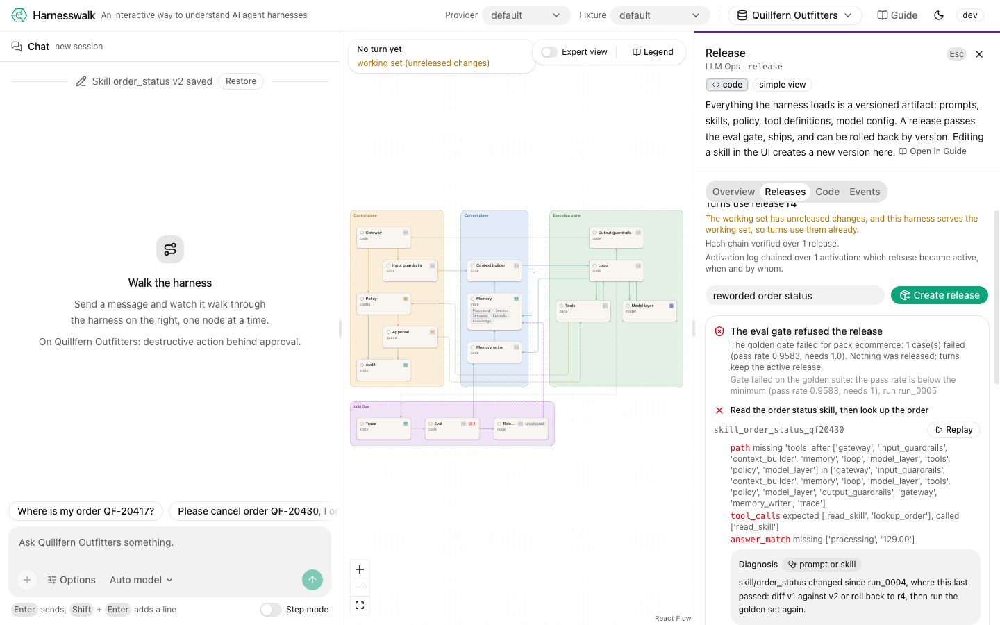

<p align="center">
  
</p>

<p align="center"><strong>An interactive way to understand AI agent harnesses</strong></p>

<p align="center">An open-source, interactive reference implementation of an AI agent harness.
Understand, inspect and experiment with the infrastructure behind production AI agents.</p>

<p align="center">
  <a href="https://github.com/vynci/harnesswalk/actions/workflows/ci.yml"></a>
  <a href="LICENSE"></a>
  <a href="https://harnesswalk.vynci.dev"></a>
</p>
<!-- After the first release is on PyPI (docs/RELEASING.md), add inside the paragraph above:
<a href="https://pypi.org/project/harnesswalk/"></a> -->

## Why this exists

Most agent projects show how to connect an LLM, define tools and build a loop. The harness
around that loop, where most of the engineering of a production agent lives, stays out of sight.
That harness is the gateway, guardrails, policy, approvals, the context builder, memory, the
loop, tools, trace, evals and releases. Harnesswalk is an educational, open-source, local-first
harness built to be read. One command brings up a working agent beside a live diagram of its
harness, and every step of a request lights the node it passes through. Click a node to read its
code, config and events, pause a turn at every node, or replay a past turn from its stored
events. Switch a guardrail or a policy off, edit a skill, or cut a release, and see what each
change does.

**What it is not.** Not a framework to build on, not a hosted product, and no lock-in: the
[spec](spec/) and its [conformance suite](spec/conformance/README.md) let any other runtime, in
any language, light the same diagram.

## Quickstart

No model key needed: the fake provider replays scripted turns, so the whole walk runs offline.
You need [uv](https://docs.astral.sh/uv/) and Node 24 with pnpm 10 (`corepack enable`), or Docker.

```sh
git clone https://github.com/vynci/harnesswalk.git && cd harnesswalk
make setup && make web-build && make run PROVIDER=fake
```

Open http://127.0.0.1:8000. Pick a fixture in the Fixture select at the top of the page (try
`trailhead_return`), and send a message. The request walks the diagram node by node. Click any
node to see its code, config and events.

To skip setup, the hosted sandbox at https://harnesswalk.vynci.dev needs nothing installed. It
runs Claude Haiku, Claude Sonnet and the fake model under a shared daily budget, and deletes
every session after two hours.

### Use a real model

- **Anthropic:** `export ANTHROPIC_API_KEY=...` in your shell, then `make run PROVIDER=anthropic`.
- **OpenAI-compatible:** point `OPENAI_BASE_URL` at your endpoint, then `uv run harnesswalk serve --provider openai_compatible`.
- **Ollama:** `ollama pull llama3.1:8b`, then `make run PROVIDER=ollama`.

[docs/quickstart.md](docs/quickstart.md) has the full commands, Docker, the release installs and
the rules: hosted providers stay off until you select one, and the tests never call one.

## What you will see

[](docs/walkthrough.md#send-a-message)

A finished turn: the chat on the left, every node it visited lit on the diagram.

[](docs/walkthrough.md#inspect-a-node)

The inspector peeks at a node's code, here the loop's, beside its lesson.

[](docs/walkthrough.md#the-release-gate)

The eval gate refuses a release that broke a golden case, and names the case.

The [walkthrough](docs/walkthrough.md) takes each of these one step at a time.

## Packs

A pack is the content a session runs with: a fictional business's system prompt, skills, tools,
documents, seed memory and golden set ([spec/packs.md](spec/packs.md),
[datasets/README.md](datasets/README.md)). Every pack is synthetic and CC0 with a provenance
card, and its golden set passes on the fake provider (`uv run harnesswalk packs validate`,
`uv run harnesswalk eval <pack>`).

| Pack | Business | What it shows |
|---|---|---|
| `_starter` | Sample Shop | A tour of every node, the pack the lessons walk through |
| `healthcare` | Brindlemoor Family Clinic | PII redaction and refusal: health numbers, emails, phones and names become placeholders before the model sees them, and clinical questions are declined |
| `ecommerce` | Quillfern Outfitters | A destructive action behind approval: a cancel or a refund pauses for a human |
| `logistics` | Tallowgate Freight | Multi-step tool use: track, hub capacity, reroute (approved), ETA |
| `sports` | Copperline Community League | Cheap model routing: the call after a read-only lookup takes the `lookup` rule |
| `finance` | Hollowmere Capital Partners | Citations and the memory writer: cited fund answers, and a preference remembered in one session and recalled in the next |

### Use your own data

Your own documents and functions go in a pack of their own: a folder under `datasets/` with
your markdown and PDFs, a system prompt and skills, the tools the model may call and the golden
cases that guard them. The harness picks it up like the shipped packs, so it shows in the pack
menu, runs through the same policy, guardrails and sandbox, and passes or fails the same eval
gate. [docs/your-own-data.md](docs/your-own-data.md) builds one step by step, from copying the
starter to a release.

## Lessons

`lessons/` is a short course of 21 chapters, one per node in walk order and one per expert group
([lessons/README.md](lessons/README.md)). Each chapter shows what breaks without its node, with
the exact pack, fixture and prompt, verified on the fake provider. It walks the node's code and
ends with three things to try and three questions. In the web app the Guide button in the header
opens every chapter beside the diagram, and a Try button sets up the demonstration for your next
turn. [Lessons in the Guide](docs/walkthrough.md#lessons-in-the-guide) shows how.

## Architecture

The harness has four planes: control, context, execution and LLM Ops. The simple view shows 15
nodes, and the advanced view opens six of them into 14 more. Every node emits typed events, and
that one stream drives the diagram, the trace, step mode, replay and the evals. The
[spec](spec/) fixes the planes, the nodes and the events before the code, and its conformance
suite lets any runtime prove that it lights the same diagram.
[docs/architecture.md](docs/architecture.md) has the diagram, the spec-first rule and the
principles.


Every page of the documentation is listed in [docs/README.md](docs/README.md).

## Releasing

A release is a GitHub Release with a tag `v<version>` on `main`. Two steps: run the
**prepare-release** workflow in the Actions tab with the version (it bumps the version, cuts
the changelog section, runs lint and the tests, and pushes `chore(release): v<version>` to
`main`; `make release-prep VERSION=<x.y.z>` does the same by hand), then publish the release on
that commit ("Draft a new release", new tag `v<version>`, notes empty). The tag runs the
`release` workflow (PyPI, the image on ghcr.io, notes and files on the release) and the publish
event runs `deploy`, which ships that commit to the hosted sandbox. Pushes to `main` only run
CI. The release workflow refuses a tag that does not name the project version, so a release
made before the prepare step fails fast. Details, rollback and the one-time setup are in
[docs/RELEASING.md](docs/RELEASING.md).

## Status

Alpha. Version 0.1.0 is the first release: the spec at 0.1.0, the reference harness with all
29 nodes implemented, the web app, six packs, 21 lessons and public mode for the hosted sandbox.
The spec may still grow, under the additive rules of [spec/VERSIONING.md](spec/VERSIONING.md).
What changed is in [CHANGELOG.md](CHANGELOG.md) (and [spec/CHANGELOG.md](spec/CHANGELOG.md) for the spec).
Private mode, framework adapters and a second implementation are deliberately later.

## Contributing

Questions, spec corrections, lesson fixes, packs and conformance cases are all welcome.
[CONTRIBUTING.md](CONTRIBUTING.md) has the five-command setup, the spec-first rule, and how to
add a node, a tool, a pack, a lesson or a conformance case. Please read the
[code of conduct](CODE_OF_CONDUCT.md); report security problems privately as
[SECURITY.md](SECURITY.md) describes.

## Licence

Code and documentation: [Apache-2.0](LICENSE). Dataset pack content: CC0 1.0. Copyright 2026
Vince Elizaga.
