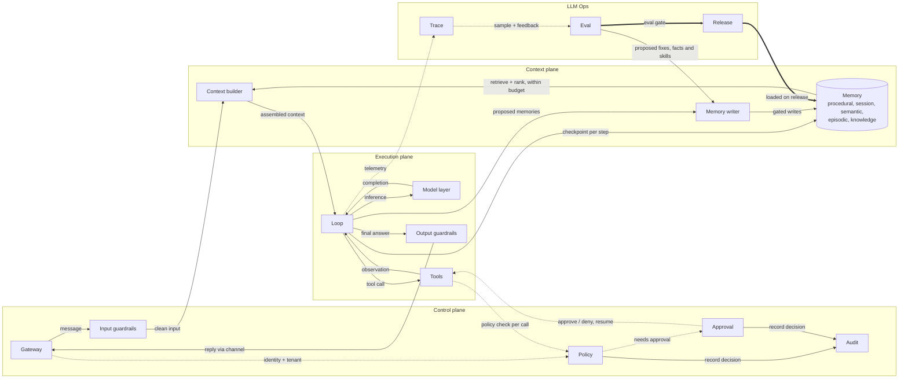

# Architecture

How Harnesswalk is put together: the planes and nodes of the diagram, the event stream that
drives everything you see, and the spec that comes before the code. For the files behind it, see
[repository.md](repository.md).

An agent is a model inside a harness. The harness is everything else. The gateway decides who is
asking. The guardrails check what goes in and out. The policy decides which tools may run. The
context builder chooses what the model sees. Memory holds what the model reads, and the memory
writer gates what it writes. Around them run the loop, the tools, the trace, the evals and the
release process.

## Which harness this models

There is no canonical agent harness, so it matters which one a diagram shows. Harnesswalk models
a governed assistant: a multi-tenant chat agent that answers people, reads company documents,
calls a few domain tools, and is run by a team that needs policy, approvals, an audit trail,
evals and releases. That is the shape of a customer-facing support or operations agent.

It does not model the coding-agent harness: a single user, a filesystem and a shell as the main
tools, subagents, hooks, compaction by resetting the context, planning files, and long runs that
span many context windows. Those pieces solve different problems and would need different nodes.
Where the two shapes share a part (the loop, the model layer, the trace, the evals), what you
learn here transfers; where they differ, do not expect to find it here.

The nodes were designed, not grown. Each has a "what breaks without it" demonstration in the
Guide, built so a learner can watch the failure. In a real system the advice from people who run
agents in production is the opposite order: add a control when the model fails without it, tie
it to the failure it fixes, and remove it when the model no longer needs it. Treat the full
diagram as a map of what can exist, not a list of what you must build. Since spec 0.2.0 the
[profiles](#profiles-and-the-ladder) let you walk it in that order: six harness shapes from a
bare loop to the full diagram, each pack on one of them.

## Planes and nodes

The harness has four planes. The simple view shows 15 nodes. The advanced view opens six of them
into 14 more, so the full diagram has 29.

| Plane | Simple view | Opened in the advanced view |
|---|---|---|
| Control plane | Gateway, Input guardrails, Policy, Approval, Audit | |
| Context plane | Context builder, Memory, Memory writer | Memory: Procedural, Session, Semantic, Episodic, Knowledge |
| Execution plane | Loop, Model layer, Tools, Output guardrails | Model layer: Router, Providers. Tools: Registry, Sandbox |
| LLM Ops | Trace, Eval, Release | Trace: Cost. Eval: Online eval, Offline eval, Diagnose. Release: Artifacts |

The control plane decides who is asking, what they may do and who must approve, and keeps the
permanent record. The context plane decides what the model sees and holds the single gated path
that writes memory. The execution plane runs the loop, the models it calls, the tools it runs and
the checks on what it says. LLM Ops sits outside the runtime: traces and cost, evaluation, and the
release of versioned artifacts back into the harness.

This is the simple view:

Solid arrows carry requests and data. Dotted arrows carry control and telemetry. Thick arrows
carry releases.

## Profiles and the ladder

A profile is a named harness shape: which nodes are switched off, and the config that goes with
that. Six ship in [config/profiles/](../config/profiles/), and each rung adds to the one below
it. The normative text is section 10 of [spec/harness.md](../spec/harness.md).

| Rung | Profile | Adds | The failure that motivates the next rung |
|---|---|---|---|
| 1 | `minimal` | Gateway, context builder (system prompt and session), loop, model layer and router, tools, trace | Personal data reaches the model and the trace; an injected instruction has the user's authority |
| 2 | `guarded` | Input and output guardrails | The model invents a policy the documents state |
| 3 | `grounded` | Knowledge retrieval and the citation check | The user has to repeat what they said last session |
| 4 | `remembered` | Memory writer, semantic and episodic memory, a model that summarises old turns | A cancel runs with no human in the loop, and nobody can say who allowed it |
| 5 | `governed` | Policy, approval and audit | A change ships without anyone checking it against the golden set |
| 6 | `operated` | Online judging, automatic diagnosis, the release gate: every node on | |

Each pack names its profile in `pack.yaml`; `HARNESSWALK_PROFILE` (a name or a path) runs every
pack on one profile instead. A switched-off node is **dimmed, never hidden**: the diagram keeps
every node in the same place, the node still enters and exits its span where it would have run
(status `skipped`, `summary.disabled: true`), and `turn_start.summary.profile` names the shape.
Some nodes never switch off (the gateway, the loop, the model layer and the router, the tools,
the context builder, the trace, offline eval, the release store); the spec says why for each.
Approval switched off is fail-closed: an action that needs a human is denied, never run, and a
pack may sit below `governed` only when none of its tools needs one. A public server never
switches off the guardrails, policy, approval or audit, whatever the profile says.

Where each pack sits was measured, not guessed: its golden set on the fake provider, on every
rung. A pack goes on the lowest rung that passes, or higher.

| Pack | `minimal` | `guarded` | `grounded` | `remembered` | `governed` | `operated` | Profile |
|---|---|---|---|---|---|---|---|
| `_starter` | 10/16 | 12/16 | 15/16 | 15/16 | 16/16 | 16/16 | `operated` (the tour, and the public site's default) |
| `healthcare` | 10/25 | 18/25 | 25/25 | 25/25 | 25/25 | 25/25 | `grounded` |
| `sports` | 16/22 | 16/22 | 22/22 | 22/22 | 22/22 | 22/22 | `grounded` |
| `ecommerce` | 7/24 | 7/24 | 13/24 | 13/24 | 24/24 | 24/24 | `governed` |
| `logistics` | 12/24 | 12/24 | 20/24 | 20/24 | 24/24 | 24/24 | `governed` |
| `finance` | 7/25 | 9/25 | 22/25 | 25/25 | 25/25 | 25/25 | `operated` |
| `device_fleet` | 14/28 | 14/28 | 21/28 | 21/28 | 28/28 | 28/28 | `governed` |
| `gov_services` | 8/27 | 10/27 | 27/27 | 27/27 | 27/27 | 27/27 | `grounded` |
| `long_session` | 12/20 | 12/20 | 17/20 | 20/20 | 20/20 | 20/20 | `remembered` |
| `helpdesk_lite` | 21/21 | 21/21 | 21/21 | 21/21 | 21/21 | 21/21 | `minimal` |

Run it yourself: `HARNESSWALK_PROFILE=minimal uv run harnesswalk eval healthcare --suite golden
--provider fake`. The conformance suite runs under every profile too
(`make conformance`); a case that needs a switched-off node is skipped, not failed. Every profile
uses the same layout today; a layout per profile is a later addition.

## The event stream

Every node emits typed events, and the event stream is the product. The contract is
[spec/events.schema.json](../spec/events.schema.json), described in
[spec/events.md](../spec/events.md) with its OpenTelemetry mapping. One stream drives everything
you see:

- **The diagram** lights each node as its events arrive.
- **The trace** stores the stream, with a receipt per node and per model call.
- **Step mode** pauses the stream at every node until you press Next.
- **Replay** walks a stored stream back and forth without calling the model again.
- **The evals** score a golden case by the path, the tool calls and the answer its stream holds.

Emit the same events from any language and you get the same UI.

## The spec comes first

The contract is in [`spec/`](../spec/), written before the code:

| Path | What it fixes |
|---|---|
| [spec/harness.md](../spec/harness.md) | Planes, nodes, invariants, the multi-tenant rule, modes |
| [spec/diagram/](../spec/diagram/) | Canonical node ids, edges, lessons, walk order |
| [spec/events.schema.json](../spec/events.schema.json), [spec/events.md](../spec/events.md) | The harness event contract and its OpenTelemetry mapping |
| [spec/contracts/](../spec/contracts/) | One interface per component, plus the HTTP API |
| [spec/conformance/](../spec/conformance/) | Black-box cases any implementation can run |

The reference implementation is Python (FastAPI, no agent framework) in
[`harnesswalk/`](../harnesswalk/). The TypeScript web UI is in [`web/`](../web/). A change in
behaviour starts in the spec, and [CONTRIBUTING.md](../CONTRIBUTING.md#the-spec-is-the-contract)
has the rules.

Another implementation proves itself with the conformance suite. The suite runs against any HTTP
harness, through `tests/conformance/runner.py --command` or `--base-url`, as
[spec/conformance/README.md](../spec/conformance/README.md) explains. The spec's version rules
are in [spec/VERSIONING.md](../spec/VERSIONING.md). Any runtime that passes the suite, in any
language, lights the same diagram.

## The diagram cannot drift

The diagram is data, in [spec/diagram/diagram.json](../spec/diagram/diagram.json). Node and edge
ids live only there. A module registers under an id at import time, and an unknown id fails right
there. The running harness serves the diagram from its registered components (`GET /v1/diagram`),
so the picture cannot drift from the code. Tests keep the diagram on this page, the lessons index
and the module map in [harnesswalk/README.md](../harnesswalk/README.md) in step with it.

## Principles

1. **Glass box.** Every component is small, readable and inspectable from the UI.
2. **The event stream is the product.** The animation, the trace store, step mode, replay and
   the evals all read the same stream.
3. **Code for controls, text for intent.** Guardrails, policy and budgets are code and config.
   Prompts and skills carry intent. The UI shows which is which.
4. **Local-first.** It runs offline with a local model. Hosted models are optional.
5. **Learn by poking.** Edit a skill, change a budget, add a policy rule or switch a node off.
   Then run the same prompt again and watch the diagram change.
6. **Framework-free core.** The loop is plain code you can read. Agent frameworks appear only as
   optional adapter examples that show where they would plug in.
