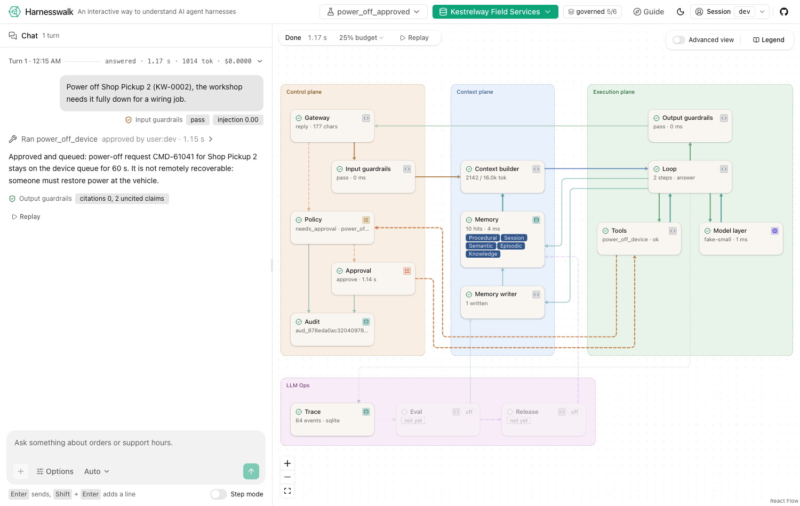

# Generate your own harness

Harnesswalk has three verbs: read a harness (the web app and the Guide), grow one (packs and
profiles), and generate your own. `harnesswalk init` writes a repository you own: plain Python,
one file per node, with your pack, its golden set, an eval gate, the conformance suite and,
with a local model, a compose file that serves it. The output has no runtime dependency on
Harnesswalk. Its proof is the spec: a generated repo runs the same conformance cases the
reference passes, under its own profile, and the Harnesswalk web app draws its walk.

```sh
uv run harnesswalk init --profile minimal  --pack helpdesk_lite --out ../my-helpdesk
uv run harnesswalk init --profile governed --pack device_fleet  --out ../my-fleet-desk
cd ../my-fleet-desk && make setup && make eval && make conformance && make serve
```

## The inputs

A generated repo is a function of three inputs, written to `harness.yaml` in the output so an
upgrade renders the same shape again:

- **A profile**: the node set (`spec/harness.md` section 10). `minimal`, `guarded`, `grounded`,
  `remembered` or `governed`. The top rung, `operated`, needs online eval, diagnose and the
  release gate, which have no templates yet, so `init` refuses it and says so.
- **A pack**: the content (`spec/packs.md`), a pack id under `datasets/` or a path to your own
  pack directory. Without `--profile` the pack's card decides.
- **A generator manifest**: what a profile does not say.

| Flag | Values | Default | Notes |
|---|---|---|---|
| `--provider` | `ollama`, `anthropic`, `fake` | `ollama` | The real model next to the always-present fake provider |
| `--model` | a model name | `qwen3.5:4b` (Ollama), `claude-haiku-5-5` | |
| `--transport` | `http`, `cli` | `http` | `cli` drops the HTTP API, so no web app and no conformance run |
| `--storage` | `sqlite`, `files` | `sqlite` | `files` keeps JSON Lines per table under `data/` |
| `--release` | `file_door`, `chain` | `chain` from `governed` up | `file_door`: your files, versioned by git; `chain`: the hash-chained release store in miniature, with artifacts, releases and rollback over HTTP |
| `--tune` | flag | off | Adds `curate` and `tune` in miniature: `python -m harness tune curate` keeps the golden turns a teacher passes as a chat dataset, `tune run` hands it to the `fake` trainer or writes what an `external` LoRA run needs. No compare, promote or canary |

Modes are not a flag: only `dev` is generated. Public and private mode (anonymous tenants,
rate limits, a hosted budget, bring-your-own keys, the TTL sweeper) stay in the reference.

## What you get

```
harness/core/       managed: one file per node, the gateway walk, the stores, the HTTP API
prompts/ skills/ policy/ tools/   yours: the pack's system prompt, skills, policy rules, tools
packs/<pack>/       yours: documents, seeds, golden set and fake fixtures
config/             yours: harness.yaml (models, router, budgets, guardrails) and the profiles
evals/              yours: the golden runner, and how CI gates on it
tests/              the vendored conformance suite and runner (managed), golden and lock tests
artifacts/          the Modelfile for the served model, and release.json (the artifact hashes)
compose.yaml        harness + Ollama + the served model (with --provider ollama)
harness.yaml        the generator manifest
harness.lock        template set and spec version, and the hash of every generated file
.harnesswalk/pristine/   the managed files as generated (the base of a three-way upgrade)
GENERATION_NOTES.md      the HTTP routes served, and everything that could not be mapped
README.md           the walkthrough for that repo: its nodes, why each exists, when to remove it
```

The runtime needs Python 3.12 and `pyyaml`; the HTTP server, SQLite, the Ollama and Anthropic
clients and the SSE stream are the standard library. The tests add `pytest`, `httpx` and
`jsonschema`. Sizes, measured: a `minimal` repo is about 2,300 lines of Python in `harness/`
(2,800 with tests and evals), a `governed` one about 3,400 (3,900), against about 24,000 in the reference package.

## How the code is produced

Template first (option B of the agent-builder design). The templates under
`harnesswalk/gen/templates/python/` are a second, deliberately small implementation of the
spec, one file per node, with the node's contract and its lesson as the docstring. A template
is plain Python with line directives (`#% if has("policy")`) and `@@name@@` values
(`harnesswalk/gen/render.py`); `templates/python/manifest.yaml` lists every output file, the
condition it is emitted under, and the node ids it implements.

**Seams, not deletions.** A node the profile switches off is not deleted from a copy of the
reference: the walk still reaches it, and one helper, `off_node(turn, node_id, **summary)`,
opens its span and exits `skipped` with `disabled: true`. So the stream has the same shape on
every rung, the conformance paths match, and the diagram dims the node instead of losing it.
The three places the reference couples nodes (tools calling policy, approval and audit; the
gateway reaching into the memory writer; the context builder into the stores) are seam
functions in the templates, each importing its node only where it calls it.

**Other languages.** A TypeScript set would be `templates/typescript/manifest.yaml` beside
the Python one; the drift tests apply to every set. For a language without a template set, and
for pack-specific tools, the path is a coding agent working from the spec (option C): the
contracts and the conformance suite are the prompt, and `make conformance` is the acceptance
test. It is documented, not built: never ship that output without the suite passing.

## Proving it

Every generated repo carries the gate it was generated with:

```sh
make eval           # the pack's golden set on the fake provider
make conformance    # the conformance suite under the repo's profile, fake provider
make test           # both, plus a check that no file imports Harnesswalk
```

The vendored runner (`tests/conformance/runner.py`) follows the suite's protocol over HTTP: it
starts `python -m harness serve` per case, drives turns, approvals, step mode, cancel and a
restart, and asserts the stream. A case is skipped, never failed, when the profile switches off
a node it requires, when it runs in public mode (never generated), or when it needs the release
chain on a file-door repo, or when it drives the tuning HTTP API (`/v1/tune`), which is not
generated. This repository's own runner gives the same verdict through its
`--command` mode (`tests/unit/test_gen_init.py` runs both):

| Output | Profile | Conformance (fake) | Golden (fake) |
|---|---|---|---|
| `helpdesk_lite` | `minimal` | 2 of 2 (30 skipped: 26 need nodes `minimal` switches off, 4 public mode) | 21 of 21 |
| `device_fleet` | `governed` | 21 of 21 (11 skipped: 4 public mode, 3 drive the tuning API, 2 need `diagnose` or the release gate, 2 pinned to `minimal`) | 28 of 28 |

Against a real model, `make conformance-model` (or `--provider ollama` with
`HARNESSWALK_OLLAMA_URL`) runs the same suite on the served model. The `cost` assertions are
dropped (the fixtures script token counts), and a case whose fixture scripts tool calls is
marked `scripted`: its walk depends on the model choosing that tool, so a failure there is the
model's choice, not a broken harness.

## Watching it in the web app

The generated server speaks the subset of `spec/contracts/http_api.md` the web app and the
runner need (GENERATION_NOTES.md lists it). In a Harnesswalk checkout:

```sh
cd ../my-fleet-desk && make serve                      # 127.0.0.1:8000
cd harnesswalk && HARNESSWALK_API_URL=http://127.0.0.1:8000 make web-dev   # 127.0.0.1:5173
```



## Upgrading

```sh
uv run harnesswalk upgrade ../my-fleet-desk       # writes branch harnesswalk/upgrade-<version>
uv run harnesswalk gen diff ../my-fleet-desk      # your edits to managed files, against a fresh render
```

`harness/core/` and `tests/conformance/` are managed; everything else is yours and an upgrade
never reads or writes it. For each managed file the upgrade has three versions: the pristine
copy from `.harnesswalk/pristine/`, the new template rendered with your `harness.yaml`, and
your committed file. Untouched by you, the file takes the template; changed by both, `git
merge-file` merges them and leaves conflict markers where they overlap, and the upgrade lists
those files. Codemods keyed to the template version in `harness.lock` run after the merge
(`harnesswalk/gen/codemods.py`) and are recorded so they run once. Everything happens in a
temporary worktree on a new branch, committed there: your working tree is never changed, and
you merge the branch when you have read it.

## Running on a local model

`--provider ollama` generates a `local` model alias (thinking off, temperature 0, a 16K
context) and `compose.yaml`: Ollama, a one-shot `model` service that pulls the base model and
builds `harness-model` from `artifacts/Modelfile`, and the harness on port 8000. Without
Docker, point the harness at any Ollama:

```sh
HARNESSWALK_OLLAMA_URL=http://<ollama-host>:11434 make serve PROVIDER=ollama
HARNESSWALK_OLLAMA_URL=http://<ollama-host>:11434 make conformance-model
```

On a shared GPU box (a homelab), the load is light: one model, one case at a time, a few
thousand tokens per call. Check `curl $HARNESSWALK_OLLAMA_URL/api/ps` first and wait when a
large model is loaded for training or curation; the conformance and golden numbers above are
on the fake provider, which is what CI runs.

## Licence

The templates are Apache-2.0, like the rest of Harnesswalk. The generated code carries no
obligation: it is yours under any licence you choose. Pack content stays CC0-1.0.
